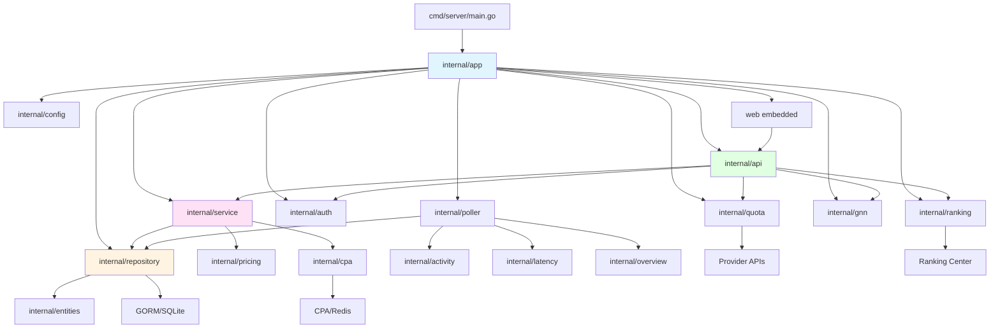

# CPA Usage Keeper — Enhanced Code Graph & Project Map

> **Purpose:** This document provides a comprehensive structural map of the entire codebase—modules, dependencies, data flow, and integration points. Use it as your **primary reference** when exploring the project to minimize file reads and accelerate orientation for AI agents and developers.
>
> **Last Updated:** 2026-10-13

---

## Table of Contents

1. [System Context](#1-system-context)
2. [Backend Code Structure](#2-backend-code-structure)
3. [Repository Layer Deep Dive](#3-repository-layer-deep-dive)
4. [Service Layer Deep Dive](#4-service-layer-deep-dive)
5. [Background Runners & Agents](#5-background-runners--agents)
6. [Frontend Architecture](#6-frontend-architecture)
7. [API Surface Map](#7-api-surface-map)
8. [Data Flow Diagrams](#8-data-flow-diagrams)
9. [Extension Points & Integration Patterns](#9-extension-points--integration-patterns)
10. [Key Files Reference Index](#10-key-files-reference-index)
11. [Common Query Paths](#11-common-query-paths)
12. [Verification & Testing](#12-verification--testing)

---

## 1. System Context

```
                  ┌─────────────────────┐
                  │   CLIProxyAPI (CPA) │
                  │  (LLM proxy, in-    │
                  │   memory usage)     │
                  └─────────┬───────────┘
                            │ usage events (Redis pub/sub,
                            │  Redis list queue, or HTTP pull)
                            │ control messages (metadata changes)
                            ▼
┌────────┐        ┌──────────────────────────┐        ┌────────────────┐
│ Browser│◄──────►│  CPA Usage Keeper        │◄──────►│  Optional:     │
│ (SPA)  │  HTTP  │  Go server + SQLite      │ HTTPS  │  Ranking Center│
└────────┘        │  (embedded web/dist)     │        │  GitHub Updates│
                  └──────────┬───────────────┘        └────────────────┘
                             │ file backups / logs / archive
                             ▼
                        WORK_DIR (./data)
```

**Key facts:**
- Single Go process embedding the built React SPA (`web/dist`)
- SQLite as the only persistent store (under `WORK_DIR`, default `./data`)
- Optional Redis for ingestion (alternatives: HTTP pull, Redis list queue)
- Optional egress: ranking center (keepers.cc.cd), GitHub update checks
- CGO required (SQLite via `mattn/go-sqlite3`)
- Go 1.26, React 19, TypeScript strict mode

---

## 2. Backend Code Structure

### 2.1 Entry Point → Assembly → Layers

```
cmd/server/main.go
    │
    ├─ Parse flags: --env, --host, -v/--version
    ├─ Configure bootstrap logging
    └─ Call internal/app.New() + Run()
            │
            ▼
internal/app/app.go (APPLICATION ASSEMBLY)
    │
    ├─ Database pool (writer/reader via dbresolver)
    ├─ Repositories (data access layer)
    ├─ Services (business logic)
    ├─ Runners (background agents)
    ├─ API router (Gin)
    └─ HTTP server
            │
            ▼
        ┌───────────────────────────────────────┐
        │         API LAYER (thin handlers)     │
        │       internal/api/router.go          │
        │   - parse/validate → call service →   │
        │     map DTO, never see GORM types     │
        └───────────────────────────────────────┘
                        │
                        ▼
        ┌───────────────────────────────────────┐
        │      SERVICE LAYER (business logic)   │
        │         internal/service/             │
        │   - usage, identities, pricing,       │
        │     quota, auth, metadata sync        │
        └───────────────────────────────────────┘
                        │
                        ▼
        ┌───────────────────────────────────────┐
        │    REPOSITORY LAYER (data access)     │
        │       internal/repository/            │
        │   - All SQL/GORM lives here           │
        │   - Repository pattern per entity     │
        │   - Migrations in migration/          │
        └───────────────────────────────────────┘
                        │
                        ▼
        ┌───────────────────────────────────────┐
        │      ENTITIES (schema source)         │
        │         internal/entities/            │
        │   - GORM models, single source of     │
        │     schema truth                      │
        └───────────────────────────────────────┘
```

### 2.2 Module Dependency Graph (Mermaid)



### 2.3 Internal Module Responsibilities

| Module | Primary Responsibility | Key Exports | Dependencies |
|--------|------------------------|-------------|--------------|
| **cmd/server** | Binary entry point | `main()` | `internal/app`, `internal/logging`, `internal/version` |
| **internal/app** | Application assembly & lifecycle | `App`, `NewWithOptions()`, `Run()`, `Close()` | All major internal packages |
| **internal/api** | HTTP router & handlers | Gin router, handler functions | `service`, `auth`, `quota`, `ranking`, `gnn` |
| **internal/entities** | GORM models (schema source of truth) | `UsageEvent`, `RedisUsageInbox`, `CPAAPIKey`, etc. | Standard library only |
| **internal/repository** | Data access layer (all SQL/GORM) | Repository structs, query functions | `entities`, `gorm.io/gorm` |
| **internal/service** | Business logic layer | Service structs, domain operations | `repository`, `pricing`, `cpa` |
| **internal/poller** | Event ingestion & aggregation | Runners, ingest sources | `repository`, `service` |
| **internal/quota** | Provider quota management | Quota clients, refresh engine | Provider APIs |
| **internal/gnn** | Provider-Model GNN feature | Graph construction, HTTP API | `service`, `entities` |
| **internal/ranking** | Local and community ranking | Local API key ranking (default), HTTP API, optional community sync | External ranking center (optional) |
| **internal/auth** | Session management | Session store, login limiter | `repository` |
| **internal/pricing** | Price catalog & resolution | Catalog, resolver | Configuration |
| **internal/cpa** | CPA management API client | HTTP client, Redis client | External CPA instance |
| **internal/config** | Configuration loading | `Config` struct, env parsing | `godotenv` |
| **internal/helper** | Shared utilities | Redaction, cost calc, identity helpers | Standard library |
| **internal/enrichgeo** | IP enrichment (opt-in) | Reverse DNS enrichment | Standard library |
| **web** | React SPA frontend | Embedded static bundle | Node.js build chain |

---

## 3. Repository Layer Deep Dive

### 3.1 Repository Structure

The repository layer (`internal/repository/`) encapsulates **all SQL and GORM operations**. No SQL escapes this boundary.

**Core files:**
- `usage.go` (93KB) - Main usage event repository with complex queries
- `usage_identities.go` - Identity aggregation queries  
- `redis_usage_inbox.go` - CPA event inbox management
- `codex_quota_history.go` - Codex quota tracking
- `cpa_api_key.go` - CPA API key persistence
- `pricing.go`, `pricing_rules.go` - Pricing catalog
- `error_events.go` - Error event storage
- `batch.go` - Batch insert utilities
- `migration/*.go` - 20+ additive schema migrations

**Aggregation stores:**
- `activitystore/` - Activity rollup writes
- `latencystore/` - Latency rollup writes  
- `overviewstore/` - Overview hourly/daily rollup writes

### 3.2 Database Pool Architecture

```
Application Layer → GORM DB (dbresolver) → SQLite (WAL mode)
                    ├─ Writer Pool: 1 connection (all writes)
                    └─ Reader Pool: N connections (queries)
```

**Key principles:**
- **Single writer** - All writes use 1 connection to prevent SQLite lock contention
- **Read scaling** - Queries use configurable reader pool (default 4)
- **Optimistic concurrency** - Aggregation checkpoints use `WHERE name = ? AND last_processed_event_id = ?`

---

## 4. Service Layer Deep Dive

### 4.1 Key Services

| Service | File | Responsibility |
|---------|------|----------------|
| **UsageService** | `usage.go` | Overview, activity, event lists, cost resolution |
| **UsageIdentityService** | `usage_identities_service.go` | Identity stats, display names |
| **RequestLogService** | `request_log.go` | CPA request log proxying |
| **PricingService** | `pricing_service.go` | Pricing catalog access |
| **CPAAPIKeyService** | `cpa_api_keys_service.go` | API key management |
| **AuthFilesService** | `auth_files_management.go` | Auth file CRUD |
| **CredentialStatusService** | `credential_status.go` | Health calculation |
| **MetadataSyncService** | `sync.go` (44KB) | Full CPA metadata sync |

### 4.2 Service → Repository Pattern

Services orchestrate repository calls and apply business logic:

```go
// Service method
func (s *usageService) GetUsageOverview(ctx, filter) {
    // 1. Validate & resolve business entities
    apiGroupKey := s.resolveAPIGroupKey(ctx, filter.APIKeyID)
    
    // 2. Call repository with transformed filter
    overview := repository.BuildUsageOverview(db, repoFilter, pricing)
    
    // 3. Map to service DTO
    return &servicedto.UsageOverviewSnapshot{...}
}
```

---

## 5. Background Runners & Agents

### 5.1 Ingestion Pipeline

```
CPA → RedisIngestRunner → redis_usage_inboxes → RedisProcessRunner → usage_events → UsageAggregationRunner → rollups
```

**Runners (started in order by app.Run()):**
1. RedisIngest - Subscribes to CPA events
2. RedisProcess - Processes inbox → usage_events
3. UsageAggregation - Aggregates to rollup tables
4. MetadataSync - Syncs CPA metadata
5. QuotaAutoRefresh - Provider quota refresh
6. Ranking - Local API key ranking (default) and optional community ranking
7. Maintenance - Archive/retention/cleanup
8. BackupMaintenance - Scheduled backups

**Stopped in reverse order by app.Close().**

### 5.2 Aggregation Checkpoints

Fair scheduler alternates between:
- **Rollups:** overview_hourly, overview_daily, activity, latency
- **Identity:** identity_aggregation

Each checkpoint tracks `last_processed_event_id` in `usage_aggregation_checkpoints` table.

---

## 6. Frontend Code Structure

```
web/
├── src/
│   ├── App.tsx                     # Root component, routing
│   ├── main.tsx                    # Entry point (React 19, Vite)
│   ├── pages/                      # Top-level route pages
│   │   ├── UsagePage.tsx           # Main admin dashboard
│   │   ├── LoginPage.tsx           # Authentication
│   │   ├── KeyOverviewPage.tsx    # API-key viewer (scoped)
│   │   ├── KeyAnalysisPage.tsx    # API-key analysis (scoped)
│   │   └── KeyRankingPage.tsx     # API-key ranking (scoped)
│   ├── components/                 # Reusable UI components
│   │   ├── ui/                     # Bespoke UI kit (no library)
│   │   ├── dashboard/              # Dashboard shell components
│   │   └── usage/                  # Usage-specific components
│   ├── features/                   # Feature-specific domains
│   │   ├── ranking/                # Local (default) and community ranking
│   │   ├── model-gnn/              # Provider Model GNN (permanent)
│   │   └── usage/                  # Live Flow WebSocket
│   ├── stores/                     # Zustand state management
│   ├── lib/                        # Core libraries (api, types, chartjs)
│   ├── i18n/                       # i18next (en, zh, zh-TW)
│   ├── utils/                      # Utility functions
│   ├── hooks/                      # Custom React hooks
│   └── styles/                     # Global SCSS
└── dist/                           # Vite build (embedded into Go binary)
```

### Frontend Data Flow

```
User Action
    │
    ▼
Component (React)
    │
    ├─ Call API (lib/api.ts)
    │       │
    │       ▼
    │   HTTP Request → /api/v1/... (backend)
    │       │
    │       ▼
    │   Response (JSON)
    │
    ├─ Update Store (Zustand)
    │       │
    │       └─ useUsageStatsStore, useThemeStore, etc.
    │
    └─ Re-render with new data
```

---

## 4. Data Flow: Ingestion → Storage → API → Frontend

```
┌─────────────────────────────────────────────────────────────────────┐
│                        INGESTION SOURCES                            │
│  - Redis Pub/Sub (subscribe to "usage")                            │
│  - Redis List Queue (BLPOP from list)                              │
│  - HTTP Pull (poll /api/usage endpoint)                            │
└────────────────────────┬────────────────────────────────────────────┘
                         │ Raw usage events
                         ▼
        ┌────────────────────────────────────┐
        │   RedisIngest Runner               │
        │   (internal/poller)                │
        │   - Validates payloads             │
        │   - Writes to redis_usage_inboxes  │
        │   - Backoff 1s→30s on failure     │
        └────────────────┬───────────────────┘
                         │
                         ▼
        ┌────────────────────────────────────┐
        │   RedisProcess Runner              │
        │   (internal/poller)                │
        │   - Reads from redis_usage_inboxes │
        │   - Token processing (per provider)│
        │   - Writes to usage_events         │
        │   - At-least-once semantics        │
        └────────────────┬───────────────────┘
                         │
                         ▼
        ┌────────────────────────────────────┐
        │   SQLITE DATABASE                  │
        │   - usage_events (90-day hot)      │
        │   - usage_events_archive (cold)    │
        │   - usage_identities               │
        │   - usage_activity_stats           │
        │   - overview hourly/daily          │
        │   - latency_stats                  │
        │   - pricing, quota, metadata, etc. │
        └────────────────┬───────────────────┘
                         │
                         ▼
        ┌────────────────────────────────────┐
        │   UsageAggregation Runner          │
        │   (internal/poller)                │
        │   - Serial runner, per-pipeline    │
        │     checkpoints                    │
        │   - Overview hourly/daily rollups  │
        │   - Activity (short/medium/long)   │
        │   - Latency stats                  │
        └────────────────┬───────────────────┘
                         │
                         ▼
        ┌────────────────────────────────────┐
        │   API LAYER (internal/api)         │
        │   - GET /api/v1/usage/overview     │
        │   - GET /api/v1/usage/events       │
        │   - GET /api/v1/usage/activity     │
        │   - GET /api/v1/usage/analysis     │
        │   - GET /api/v1/quota/...          │
        └────────────────┬───────────────────┘
                         │ JSON responses
                         ▼
        ┌────────────────────────────────────┐
        │   FRONTEND (web/src)               │
        │   - API calls (lib/api.ts)         │
        │   - State management (Zustand)     │
        │   - Charts (Chart.js)              │
        │   - Tables, forms, modals          │
        └────────────────────────────────────┘
```

---

## 5. Background Agents (Runners)

**Started by `internal/app/app.go` in `Run()`, stopped in strict reverse order by `Close()`:**

| Runner | Package | Role |
|--------|---------|------|
| **RedisIngest** | `internal/poller` | Subscribe to CPA usage events (Redis pub/sub or list queue), write to `redis_usage_inboxes`, backoff on failure (1s→30s) |
| **RedisProcess** | `internal/poller` | Read from `redis_usage_inboxes`, token processing, write to `usage_events`, at-least-once |
| **UsageAggregation** | `internal/poller` | Serial runner with per-pipeline checkpoints (overview hourly/daily, activity, latency stats) |
| **MetadataSync** | `internal/app` | Sync Auth Files / API Keys / AI Providers / pricing from CPA (interval + control-message triggered) |
| **QuotaAutoRefresh** | `internal/quota` | Provider quota refresh workers (manual + auto), shared queue |
| **Ranking** | `internal/ranking` | Local API key ranking (default); optional community ranking client |
| **Maintenance** | `internal/app` | Retention (90-day hot/cold archive move), log cleanup |
| **BackupMaintenance** | `internal/app` | Scheduled SQLite backups |
| **CodexQuotaHistory** | `internal/quota` | Codex quota history scheduler + runner (flush, cleanup) |
| **UsageHeaderSnapshot** | `internal/quota` | Batch cache writes for usage response header snapshots |

**Failure isolation:** Optional subsystems (ranking, update check, quota, IP enrichment) must never break ingestion. Follow "inert when disabled" and failure-tolerant-cache patterns.

---

## 6. Layering Rules (Backend)

1. **Handlers are thin:** parse/validate → call service → map DTO. No business logic in `internal/api`.
2. **All SQL lives in `internal/repository`** — never above it. Handlers and services never see GORM types.
3. **Repository pattern per entity family; composition over inheritance.** Services and runners are composed in `internal/app/app.go` via constructor injection.
4. **`internal/entities` is the schema source of truth.** Schema changes go through additive migrations in `internal/repository/migration`.
5. **Single writer.** Writes go through the writer pool; reads use the reader pool. Aggregation checkpoint updates stay inside the caller's transaction with the name + expected-cursor optimistic-concurrency check.
6. **Failure isolation.** Optional subsystems must never break ingestion.
7. **Redaction.** Never log secrets — route anything key-like through `internal/helper/redact.go`.
8. **Test placement.** Co-locate `*_test.go` with the code; tests that need isolation live in a `test/` subpackage (e.g. `internal/api/test/`).

---

## 7. Frontend Conventions

- **TypeScript strict.** No `any` without justification; `typecheck` must pass.
- **No UI framework.** Extend the bespoke kit in `src/components/ui`; do not add a component-library dependency without discussion.
- **Styling:** CSS Modules per component; global layers via SCSS (dart-sass). Theming uses the `data-theme` attribute — components must look correct in light, dark, and auto.
- **i18n:** every user-facing string goes through i18next (`src/i18n`); `en`, `zh`, and `zh-TW` locale files must all be updated together.
- **Charts:** Chart.js registered only via `src/lib/chartjs.ts`.
- **Provider Model GNN panel (permanent feature):** `ProviderModelGNNPanel` must stay mounted on the Usage overview tab. Removal or replacement requires an explicit documented architectural decision recorded in `docs/ARCHITECTURE.md`, `docs/SPECIFICATION.md` (UC-12), and `session.md`.

---

## 8. Extensibility Points

| Extension | Hook |
|-----------|------|
| New quota provider | Add a client under `internal/quota`, register in `registry.go` |
| New ingest source | Implement the `IngestSource` interface in `internal/poller` |
| New analytics | Add a store under `internal/repository` + extend the aggregation runner with a new checkpoint name |
| New API surface | Thin handler in `internal/api` + service in `internal/service` |
| Storage backends | Repository layer isolates GORM/dialect specifics (single seam for a future multi-DB port) |
| UI features | Pages under `web/src/pages`, shared widgets in `components/ui`, feature folders like `features/ranking` |

---

## 9. Key Files for Agent Onboarding

| File | Purpose |
|------|---------|
| `AGENTS.md` | AI agent guidance: project overview, layering rules, verification baseline, security notes |
| `docs/ARCHITECTURE.md` | Detailed architecture: runtime topology, module layering, data flow, deployment models |
| `docs/SPECIFICATION.md` | Functional contract: purpose, users, use cases, business rules, security requirements |
| `docs/CONFIGURATION.md` | All environment variables and CLI flags |
| `docs/ROADMAP.md` | Phased future work, planned features, maintenance track |
| `docs/CONTRIBUTING.md` | Development setup, verification baseline, commit conventions, documentation policy |
| `docs/CODE_GRAPH.md` | **This file** — project map for quick orientation |
| `session.md` | AI session context: recent decisions, discoveries, pending work |
| `.env.example` | Configuration template with placeholders |
| `Makefile` | Common tasks: `make verify`, `make build`, `make test` |

---

## 7. API Surface Map

### 7.1 Public Endpoints (no auth)
- `GET /healthz` - Health check
- `POST /api/v1/auth/login` - Admin password login
- `POST /api/v1/auth/api-key-login` - API key viewer login

### 7.2 Admin Endpoints
- `GET /api/v1/usage/overview` - Usage overview with filters
- `GET /api/v1/usage/activity` - Activity time series
- `GET /api/v1/usage/events` - Event list with pagination
- `GET /api/v1/usage/identities` - Identity stats
- `GET /api/v1/usage/providers` - Grouped active AI providers with aggregate statistics
- `GET /api/v1/usage/providers/:providerId/keys` - Paginated provider key details
- `GET /api/v1/quota/*` - Quota management & history
- `GET /api/v1/ranking/*` - Community ranking
- `GET /api/v1/live-flow/ws` - Live flow WebSocket
- `GET /api/v1/gnn/graph` - Provider-model GNN graph
- `GET /api/v1/providers` - Provider metadata
- `GET /api/v1/cpa-api-keys` - CPA API keys
- `GET /api/v1/auth-files` - Auth files
- `GET /api/v1/pricing/*` - Pricing rules

### 7.3 API Key Viewer Endpoints (scoped)
- `GET /api/v1/key-overview` - Scoped to viewer's API key
- `GET /api/v1/key-activity` - Scoped activity
- `GET /api/v1/usage/providers` - Event-scoped provider aggregates
- `GET /api/v1/usage/providers/:providerId/keys` - Event-scoped keys; unavailable providers return 404

---

## 8. Key Files Reference Index

### 8.1 Critical Entry Points

| File | Purpose | Size | Key Functions |
|------|---------|------|---------------|
| `cmd/server/main.go` | Binary entry | 44 lines | `main()` |
| `internal/app/app.go` | App assembly | 900+ lines | `NewWithOptions()`, `Run()`, `Close()` |
| `internal/api/router.go` | API router | 1000+ lines | `NewRouter()`, route registration |
| `internal/repository/usage.go` | Usage queries | 2500+ lines | `ListUsageEventsWithFilter()`, `BuildUsageOverview*()` |
| `internal/service/usage.go` | Usage logic | 750+ lines | `GetUsageOverview()`, `GetUsageActivity()` |
| `internal/poller/usage_aggregation_runner.go` | Aggregation | 800+ lines | `Run()`, fair scheduler |
| `web/src/App.tsx` | Frontend shell | 400+ lines | Auth, routing, session |
| `web/src/pages/UsagePage.tsx` | Main dashboard | 2700+ lines | Overview, activity, events |

### 8.2 "Where is X?" Quick Reference

| Question | Answer |
|----------|--------|
| Where are usage events stored? | `internal/entities/usage_event.go` (schema), `internal/repository/usage.go` (queries) |
| Where is overview calculated? | `internal/repository/usage.go` → `BuildUsageOverviewWithFilterAndRecentCache()` |
| Where are API routes defined? | `internal/api/router.go` → `register*Routes()` functions |
| Where is authentication? | `internal/auth/session.go`, `internal/api/auth_handler.go` |
| Where is frontend entry? | `web/src/main.tsx` → `<App />` in `App.tsx` |
| Where is quota refresh? | `internal/quota/refresh_engine.go` |
| Where is pricing resolved? | `internal/pricing/resolver.go` |
| Where are migrations? | `internal/repository/migration/*.go` |
| Where is GNN feature? | Backend: `internal/gnn/`, Frontend: `web/src/features/model-gnn/` |
| Where is ranking? | Backend: `internal/ranking/`, Frontend: `web/src/features/ranking/` |

### 8.3 Feature Location Map

| Feature | Backend | Frontend |
|---------|---------|----------|
| Provider Model GNN | `internal/gnn/` + `internal/gnn/httpapi/` | `web/src/features/model-gnn/ProviderModelGNNPanel.tsx` |
| Community Ranking | `internal/ranking/` + `internal/ranking/httpapi/` | `web/src/features/ranking/` (local by default) |
| API Key Viewer | `internal/service/` (scoped queries) | `web/src/features/key-viewer/`, `web/src/pages/Key*.tsx` |
| Live Flow | `internal/cpa/liveflow.go` (WebSocket proxy) | `web/src/features/usage/` (WebSocket client) |
| Quota Management | `internal/quota/` (clients + refresh engine) | `web/src/features/usage/quota/` |
| Request Logs | `internal/service/request_log.go` (CPA proxy) | API-driven download |

---

## 9. Extension Points & Integration Patterns

### 9.1 Adding a New Quota Provider
1. Create client in `internal/quota/` implementing `QuotaClient` interface
2. Register in `internal/quota/registry.go`
3. Wire in `internal/app/app.go` quota engine setup
4. Add frontend UI in `web/src/features/usage/quota/`

### 9.2 Adding a New Ingest Source
1. Implement `IngestSource` interface in `internal/poller/`
2. Wire in `internal/app/app.go` runner setup
3. Add configuration env vars in `internal/config/config.go`

### 9.3 Adding New Analytics Pipeline
1. Add aggregation store under `internal/repository/` (e.g., `newmetricstore/`)
2. Create checkpoint name in `usage_aggregation_checkpoints` table
3. Extend `UsageAggregationRunner` in `internal/poller/usage_aggregation_runner.go`
4. Add API endpoint in `internal/api/` + service method

### 9.4 Adding New API Surface
1. Define handler function in `internal/api/`
2. Create service method in `internal/service/`
3. Add repository queries if needed in `internal/repository/`
4. Register route in `router.go` with appropriate middleware
5. Add frontend API client call in `web/src/lib/api.ts`

---

## 10. Verification Baseline

Run before opening a PR:

```bash
make verify
```

Which executes:

```bash
go test ./cmd/... ./internal/...      # backend tests (Go 1.26, CGO on)
npm --prefix ./web ci                 # install web deps
npm --prefix ./web run test           # vitest
npm --prefix ./web run lint           # eslint
npm --prefix ./web run typecheck      # tsc --noEmit (strict)
npm --prefix ./web run build          # vite production build
```

**Note:** The production capacity suite under `internal/benchmark/` is **not** part of the baseline. It is a Linux-only, on-demand harness (amd64 + cgroup v2 + systemd) run via `internal/benchmark/scripts/run-capacity.sh`. See `internal/benchmark/REPORT.md` for capacity measurements.

---

## 11. Related Documents

- [README.md](../README.md) — Quick start & deployment recipes
- [ARCHITECTURE.md](ARCHITECTURE.md) — Detailed architecture, module layering, data flow
- [SPECIFICATION.md](SPECIFICATION.md) — Functional contract, use cases, business rules
- [CONFIGURATION.md](CONFIGURATION.md) — Complete env vars & CLI flags reference
- [ROADMAP.md](ROADMAP.md) — Phased future work & planned features
- [CONTRIBUTING.md](CONTRIBUTING.md) — Development setup, workflow, conventions
- [AGENTS.md](../AGENTS.md) — AI agent guidance & project rules
- [CHANGELOG.md](../CHANGELOG.md) — Notable changes & release history
- [session.md](../session.md) — AI session context (kept current)

---

**End of Enhanced Code Graph. Use this document as your primary reference to minimize file reads and accelerate codebase navigation. When exploring the project, consult this map first before making tool calls.**
