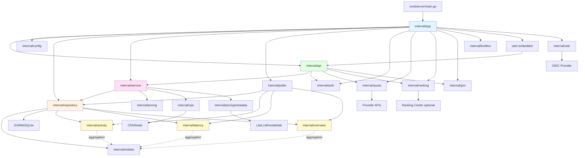

# CPA Usage Keeper — Enhanced Code Graph & Project Map

> **Purpose:** This document provides a comprehensive structural map of the entire codebase—modules, dependencies, data flow, and integration points. Use it as your **primary reference** when exploring the project to minimize file reads and accelerate orientation for AI agents and developers.
>
> **Last Updated:** 2026-11-15  
> **Last Scanned Commit:** `de134fda6689301b55a9c7ed567d8d6e0efb164e` (2026-11-14 14:55:22 +0700)  
> **Commit Message:** Merge tag 'v2.1.1' into dev

---

## Table of Contents

1. [System Context](#1-system-context)
2. [Backend Code Structure](#2-backend-code-structure)
3. [Repository Layer Deep Dive](#3-repository-layer-deep-dive)
4. [Service Layer Deep Dive](#4-service-layer-deep-dive)
5. [Background Runners & Agents](#5-background-runners--agents)
6. [Frontend Architecture](#6-frontend-architecture)
7. [API Surface Map](#7-api-surface-map)
8. [Data Flow Diagrams](#8-data-flow-diagrams)
9. [Extension Points & Integration Patterns](#9-extension-points--integration-patterns)
10. [Key Files Reference Index](#10-key-files-reference-index)
11. [Common Query Paths](#11-common-query-paths)
12. [Verification & Testing](#12-verification--testing)

---

## 1. System Context

```
                  ┌─────────────────────┐
                  │   CLIProxyAPI (CPA) │
                  │  (LLM proxy, in-    │
                  │   memory usage)     │
                  └─────────┬───────────┘
                            │ usage events (Redis pub/sub,
                            │  Redis list queue, or HTTP pull)
                            │ control messages (metadata changes)
                            ▼
┌────────┐        ┌──────────────────────────┐        ┌────────────────┐
│ Browser│◄──────►│  CPA Usage Keeper        │◄──────►│  Optional:     │
│ (SPA)  │  HTTP  │  Go server + SQLite      │ HTTPS  │  Ranking Center│
└────────┘        │  (embedded web/dist)     │        │  GitHub Updates│
                  └──────────┬───────────────┘        └────────────────┘
                             │ file backups / logs / archive
                             ▼
                        WORK_DIR (./data)
```

**Key facts:**
- Single Go process embedding the built React SPA (`web/dist`)
- SQLite as the only persistent store (under `WORK_DIR`, default `./data`)
- Optional Redis for ingestion (alternatives: HTTP pull, Redis list queue)
- Optional egress: ranking center (keepers.cc.cd), GitHub update checks
- CGO required (SQLite via `mattn/go-sqlite3`)
- Go 1.26, React 19, TypeScript strict mode

---

## 2. Backend Code Structure

### 2.1 Entry Point → Assembly → Layers

```
cmd/server/main.go
    │
    ├─ Parse flags: --env, --host, -v/--version
    ├─ Configure bootstrap logging
    └─ Call internal/app.New() + Run()
            │
            ▼
internal/app/app.go (APPLICATION ASSEMBLY)
    │
    ├─ Database pool (writer/reader via dbresolver)
    ├─ Repositories (data access layer)
    ├─ Services (business logic)
    ├─ Runners (background agents)
    ├─ API router (Gin)
    └─ HTTP server
            │
            ▼
        ┌───────────────────────────────────────┐
        │         API LAYER (thin handlers)     │
        │       internal/api/router.go          │
        │   - parse/validate → call service →   │
        │     map DTO, never see GORM types     │
        └───────────────────────────────────────┘
                        │
                        ▼
        ┌───────────────────────────────────────┐
        │      SERVICE LAYER (business logic)   │
        │         internal/service/             │
        │   - usage, identities, pricing,       │
        │     quota, auth, metadata sync        │
        └───────────────────────────────────────┘
                        │
                        ▼
        ┌───────────────────────────────────────┐
        │    REPOSITORY LAYER (data access)     │
        │       internal/repository/            │
        │   - All SQL/GORM lives here           │
        │   - Repository pattern per entity     │
        │   - Migrations in migration/          │
        │   - Uses aggregation domain packages  │
        └───────────────────────────────────────┘
                        │
                        ├──────────────────┐
                        ▼                  ▼
        ┌──────────────────────┐  ┌────────────────────────┐
        │ ENTITIES (schema)    │  │ AGGREGATION DOMAINS    │
        │ internal/entities/   │  │ internal/activity/     │
        │ - GORM models        │  │ internal/latency/      │
        │ - Table definitions  │  │ internal/overview/     │
        └──────────────────────┘  │ - Pure aggregation     │
                                  │ - Grain/bucket logic   │
                                  │ - No GORM dependencies │
                                  └────────────────────────┘
```

### 2.2 Module Dependency Graph (Mermaid)



### 2.3 Internal Module Responsibilities

| Module | Primary Responsibility | Key Exports | Dependencies |
|--------|------------------------|-------------|--------------|
| **cmd/server** | Binary entry point | `main()` | `internal/app`, `internal/logging`, `internal/version` |
| **internal/app** | Application assembly & lifecycle | `App`, `NewWithOptions()`, `Run()`, `Close()` | All major internal packages |
| **internal/api** | HTTP router & handlers | Gin router, handler functions | `service`, `auth`, `quota`, `ranking`, `gnn` |
| **internal/entities** | GORM models (schema source of truth) | `UsageEvent`, `RedisUsageInbox`, `CPAAPIKey`, etc. | Standard library only |
| **internal/repository** | Data access layer (all SQL/GORM) | Repository structs, query functions | `entities`, `activity`, `latency`, `overview`, `gorm.io/gorm` |
| **internal/service** | Business logic layer | Service structs, domain operations | `repository`, `pricing`, `pricingmetadata`, `cpa` |
| **internal/poller** | Event ingestion & aggregation | Runners, ingest sources, control messages | `repository`, `service`, `activity`, `latency`, `overview` |
| **internal/activity** | Activity aggregation domain | Grain bucketing (short/medium/long/daily), retention logic | `entities`, `timeutil` (no GORM) |
| **internal/latency** | Latency aggregation domain | Hour/day bucket logic, sketch encoding, sample sets | `entities`, `activity`, `timeutil` (no GORM) |
| **internal/overview** | Overview aggregation domain | Hour/day stats, speed calculation | `entities`, `timeutil` (no GORM) |
| **internal/quota** | Provider quota management | Quota clients, refresh engine | Provider APIs |
| **internal/gnn** | Provider-Model GNN feature | Graph construction, HTTP API | `cpa`, `entities` |
| **internal/liveflow** | Live Flow model history | Period windows, on-demand model aggregation service (alias-grouped), HTTP API | `repository`, `timeutil` |
| **internal/ranking** | Local and community ranking | Local API key ranking (default), HTTP API, optional community sync | External ranking center (optional) |
| **internal/auth** | Session management | Session store, login limiter, OIDC session policy | `repository`, `oidc` |
| **internal/oidc** | OpenID Connect client | Discovery, token verification, claims extraction | OIDC provider |
| **internal/pricing** | Price catalog & resolution | Catalog, resolver | Configuration |
| **internal/pricingmetadata** | External pricing metadata | LiteLLM client, modelslab scraping | External pricing sources |
| **internal/cpa** | CPA management API client | HTTP client, Redis client, live flow proxy | External CPA instance |
| **internal/config** | Configuration loading | `Config` struct, env parsing | `godotenv` |
| **internal/helper** | Shared utilities | Redaction, cost calc, identity helpers | Standard library |
| **internal/enrichgeo** | IP enrichment (opt-in) | Reverse DNS enrichment, privacy-preserving local classification | Standard library |
| **internal/backup** | Database backup operations | SQLite backup store | `database/sql` |
| **internal/updatecheck** | GitHub release checks | Update checker | GitHub API |
| **internal/releasecheck** | Release channel coordination | Version comparison | `updatecheck` |
| **internal/benchmark** | Production capacity suite (test-only) | Capacity harness, workload generators | Not part of runtime |
| **web** | React SPA frontend | Embedded static bundle | Node.js build chain |

---

## 3. Repository Layer Deep Dive

### 3.1 Repository Structure

The repository layer (`internal/repository/`) encapsulates **all SQL and GORM operations**. No SQL escapes this boundary. It uses pure aggregation domain packages for business logic.

**Core files:**
- `usage.go` (93KB) - Main usage event repository with complex queries
- `usage_identities.go` (50KB) - Identity aggregation queries  
- `redis_usage_inbox.go` - CPA event inbox management
- `codex_quota_history.go` - Codex quota tracking
- `cpa_api_key.go` - CPA API key persistence
- `pricing.go`, `pricing_rules.go` - Pricing catalog
- `error_events.go` - Error event storage
- `provider_models.go` - Provider/model metadata
- `batch.go` - Batch insert utilities
- `migration/*.go` - 30+ additive schema migrations

**Aggregation stores:**
- `activitystore/` - Activity rollup writes (uses `internal/activity`)
- `latencystore/` - Latency rollup writes (uses `internal/latency`)
- `overviewstore/` - Overview hourly/daily rollup writes (uses `internal/overview`)

**Aggregation domain separation:**
The three aggregation domains (`activity`, `latency`, `overview`) are **pure business logic packages** with no GORM dependencies. They:
- Live in `internal/{activity,latency,overview}/`
- Accept `[]entities.UsageEvent` and return aggregated rows
- Handle grain/bucket logic, retention calculations, and sketch encoding
- Are imported by repository stores but never import repository code
- Enable testing aggregation logic without database dependencies

### 3.2 Database Pool Architecture

```
Application Layer → GORM DB (dbresolver) → SQLite (WAL mode)
                    ├─ Writer Pool: 1 connection (all writes)
                    └─ Reader Pool: N connections (queries)
```

**Key principles:**
- **Single writer** - All writes use 1 connection to prevent SQLite lock contention
- **Read scaling** - Queries use configurable reader pool (default 4)
- **Optimistic concurrency** - Aggregation checkpoints use `WHERE name = ? AND last_processed_event_id = ?`

---

## 4. Service Layer Deep Dive

### 4.1 Key Services

| Service | File | Responsibility |
|---------|------|----------------|
| **UsageService** | `usage.go` | Overview, activity, event lists, cost resolution |
| **UsageIdentityService** | `usage_identities_service.go` | Identity stats, display names |
| **RequestLogService** | `request_log.go` | CPA request log proxying |
| **PricingService** | `pricing_service.go` | Pricing catalog access, recalculation orchestration |
| **CPAAPIKeyService** | `cpa_api_keys_service.go` | API key management |
| **AuthFilesService** | `auth_files_management.go` | Auth file CRUD |
| **CredentialsManagementService** | `credentials_management_service.go` | Credential mutation coordination |
| **CredentialStatusService** | `credential_status.go` | Health calculation |
| **CredentialPriorityService** | `credential_priority.go` | Priority management |
| **SyncService** | `sync.go` (large) | Full CPA metadata sync, usage processing |
| **ErrorEventService** | `error_events_service.go` | Error event storage and retrieval |
| **TokenProcessorService** | `tokenprocessor/` | Token counting and normalization |
| **ProviderMetadataService** | `providermetadata/` | Provider display metadata |

### 4.2 Service Composition Pattern

Services use constructor dependency injection and compose repositories:

```go
// Service assembly in internal/app/app.go
syncService := service.NewSyncServiceWithOptions(db, service.SyncServiceOptions{
    BaseURL:               cfg.CPABaseURL,
    Client:                cpaClient,
    PricingCatalog:        pricingCatalog,
    UsageRawRetentionDays: cfg.UsageRawRetentionDays,
    CredentialMetadata:    credentialMetadata,
    RecentUsageEvents:     recentUsageCache,
    UsageAggregationNotifier: usageAggregationRunner,
    UsageEventsLive:          usageEventsLive,
    UsageHeaderQuota:         quotaService,
    PluginAPIKeys:            pluginAPIKeyRunner,
})
```

---

## 5. Background Runners & Agents

### 5.1 Ingestion & Processing Pipeline

```
CPA (Redis/HTTP) → RedisIngestRunner → redis_usage_inboxes 
                                        → RedisProcessRunner → usage_events 
                                        → UsageAggregationRunner → rollup tables

CPA (Redis) → RedisErrorIngestRunner → error_events (independent, best-effort)
```

**Runners (started in order by app.Run(), stopped in reverse by app.Close()):**

1. **RedisIngest** - Subscribes to CPA usage events (Redis pub/sub, list pull, or HTTP pull)
2. **RedisProcess** - Processes inbox → usage_events (backoff 1s→30s)
3. **CPAErrors** - Independent error event subscription (best-effort, never blocks usage)
4. **UsageAggregation** - Serial aggregation runner with fair scheduling
5. **LocalRanking** - Local API key ranking (always enabled, 5-minute refresh)
6. **PluginAPIKeys** - Plugin API key synchronization
7. **MetadataSync** - CPA metadata sync (Auth Files, API Keys, AI Providers, pricing)
8. **QuotaAutoRefresh** - Provider quota refresh workers (configurable limit)
9. **Maintenance** - Storage cleanup (retention, archive, vacuum)
10. **BackupMaintenance** - Scheduled SQLite backups (optional)

### 5.2 Usage Aggregation Runner (Serial, Fair Scheduler)

The `UsageAggregationRunner` is the **single writer** for all derived aggregations. It alternates between pipelines using a fair scheduler:

**Pipelines:**
1. **Overview Hourly** - `usage_overview_hourly_stats` (uses `internal/overview`)
2. **Overview Daily** - `usage_overview_daily_stats` (uses `internal/overview`)
3. **Activity** - `usage_activity_stats` for 4 grains: short/medium/long/daily (uses `internal/activity`)
4. **Latency** - `usage_latency_stats` for hour/day buckets (uses `internal/latency`)
5. **Identity** - `usage_identities` aggregation

Each pipeline:
- Has its own checkpoint in `usage_aggregation_checkpoints` table
- Tracks `last_processed_event_id` with optimistic concurrency
- Processes batches of 1000 usage events per transaction
- Can be paused/resumed independently
- Notifies after commit to wake next pipeline

### 5.3 Metadata Sync Runner

Periodic + control-message triggered sync of CPA metadata:
- Auth Files with credential metadata snapshots
- API Keys with group/name info
- AI Providers and model catalog
- Pricing rules from CPA

Control messages from Redis trigger immediate sync without waiting for the interval.

---

## 6. Frontend Code Structure

```
web/
├── src/
│   ├── App.tsx                     # Root component, routing
│   ├── main.tsx                    # Entry point (React 19, Vite)
│   ├── StartupGate.tsx             # Startup loading gate
│   ├── pages/                      # Top-level route pages
│   │   ├── UsagePage.tsx           # Main admin dashboard (102KB)
│   │   ├── ProviderDetailPage.tsx  # Admin provider detail route
│   │   ├── LoginPage.tsx           # Authentication (OIDC + password)
│   │   ├── StartupPage.tsx         # Startup/migration screen
│   │   ├── KeyOverviewPage.tsx     # API-key viewer (scoped)
│   │   ├── KeyAnalysisPage.tsx     # API-key analysis (scoped)
│   │   ├── KeyEventsPage.tsx       # API-key request events (scoped)
│   │   ├── KeyLiveFlowPage.tsx     # API-key live flow (scoped)
│   │   └── KeyRankingPage.tsx      # API-key ranking (scoped)
│   ├── components/                 # Reusable UI components
│   │   ├── ui/                     # Bespoke UI kit (no library)
│   │   │   ├── Button, Card, Modal, Select, Table, etc.
│   │   │   ├── LanguageSwitcher    # i18n language picker
│   │   │   ├── ProviderDataDialog  # Provider raw data inspector
│   │   │   └── QuestionMarkHelp    # Inline help tooltips
│   │   ├── dashboard/              # Dashboard shell components
│   │   └── usage/                  # Usage-specific components
│   ├── features/                   # Feature-specific domains
│   │   ├── ranking/                # Local (always on) + community ranking
│   │   ├── model-gnn/              # Provider Model GNN (permanent)
│   │   │   └── ProviderModelGNNPanel.tsx (React Flow + Reagraph)
│   │   ├── usage/                  # Live Flow WebSocket
│   │   │   ├── LiveFlowPanel.tsx
│   │   │   ├── FlowTopology.tsx    # ring layout, active-block z-index
│   │   │   └── nodes/, edges/
│   │   ├── live-flow/              # Live Flow period history (fork)
│   │   │   ├── types.ts, api.ts
│   │   │   ├── periods.ts          # six periods, localStorage selection
│   │   │   ├── merge.ts            # alias-aware historical + live union
│   │   │   ├── trend.ts            # previous-period comparison
│   │   │   └── components/LiveFlowPeriodSelect.tsx
│   │   └── key-viewer/             # API key viewer features
│   ├── stores/                     # Zustand state management
│   │   ├── usageStats.ts           # Usage data store
│   │   ├── theme.ts                # Theme persistence
│   │   ├── auth.ts                 # Auth state
│   │   └── preferences.ts          # User preferences
│   ├── lib/                        # Core libraries
│   │   ├── api.ts                  # HTTP client (fetch wrapper)
│   │   ├── chartjs.ts              # Chart.js registration
│   │   └── types.ts                # Shared TypeScript types
│   ├── i18n/                       # i18next (en, zh, zh-TW)
│   ├── utils/                      # Utility functions
│   │   ├── usage/                  # Usage data utilities
│   │   │   ├── overview.ts, timeRange.ts, chartConfig.ts
│   │   │   ├── health.ts, latency.ts, serviceTier.ts
│   │   │   └── modelDisplay.ts, requestEndpoint.ts
│   │   ├── clipboard.ts, constants.ts
│   │   └── modelSort.ts
│   ├── hooks/                      # Custom React hooks
│   │   ├── useMediaQuery.ts
│   │   ├── useAnchorPosition.ts
│   │   ├── useScrollBoundaryContainment.ts
│   │   └── useHeaderRefresh.ts
│   ├── styles/                     # Global SCSS
│   │   ├── global.scss             # Entry point
│   │   ├── variables.scss, themes.scss
│   │   ├── reset.scss, layout.scss
│   │   └── components.scss, menu.scss
│   ├── embed/                      # CPAMC iframe embed mode
│   │   └── cpamcEmbed.ts
│   └── assets/                     # Static assets (icons, ranking)
└── dist/                           # Vite build (embedded into Go binary)
```

### Frontend Key Conventions

- **TypeScript strict mode** - No `any` without justification
- **No UI framework** - Bespoke component kit, no dependencies like MUI/Ant
- **CSS Modules** - Scoped per-component styles (`.module.scss`)
- **i18n mandatory** - All user-facing strings through i18next
- **Theme support** - `data-theme` attribute (light/dark/auto)
- **Chart.js** - Registered via `lib/chartjs.ts` only
- **Protected features** - Provider Model GNN panel and AI Provider Table redesign are permanent (see `AGENTS.md` §3 and `docs/MERGE-PRESERVATION.md` §6)

---

## 7. API Surface Map

### 7.1 Public Endpoints (no auth)
- `GET /healthz` - Health check
- `POST /api/v1/auth/login` - Admin password login
- `POST /api/v1/auth/api-key-login` - API key viewer login
- `GET /api/v1/auth/oidc/config` - OIDC configuration (when enabled)
- `GET /api/v1/auth/oidc/authorize` - OIDC authorization redirect
- `GET /api/v1/auth/oidc/callback` - OIDC callback handler
- `POST /api/v1/auth/oidc/logout` - OIDC logout

### 7.2 Admin Endpoints
- `GET /api/v1/usage/overview` - Usage overview with filters
- `GET /api/v1/usage/activity` - Activity time series
- `GET /api/v1/usage/events` - Event list with pagination
- `GET /api/v1/usage/identities` - Identity stats
- `GET /api/v1/usage/providers` - Aggregated AI-provider rows with server-side sorting
- `GET /api/v1/usage/providers/:providerId/keys` - Paginated provider keys with server-side sorting
- `GET /api/v1/quota/*` - Quota management & history
- `GET /api/v1/ranking/*` - Local ranking (always available) + optional community ranking
- `GET /api/v1/live-flow/ws` - Live flow WebSocket (metadata-only stream)
- `GET /api/v1/gnn/graph` - Provider-model GNN graph
- `GET /api/v1/providers` - Provider metadata
- `GET /api/v1/cpa-api-keys` - CPA API keys
- `GET /api/v1/auth-files` - Auth files
- `GET /api/v1/pricing/*` - Pricing rules
- `GET /api/v1/errors/*` - Error events (when CPA error subscription enabled)

### 7.3 API Key Viewer Endpoints (scoped)
- `GET /api/v1/key-overview` - Scoped to viewer's API key
- `GET /api/v1/key-activity` - Scoped activity
- `GET /api/v1/key-events` - Scoped request events
- `GET /api/v1/usage/providers` - Event-scoped provider aggregates
- `GET /api/v1/usage/providers/:providerId/keys` - Event-scoped keys; unavailable providers return 404
- `GET /api/v1/live-flow/ws` - Live flow (global metadata view with privacy notice)
- `GET /api/v1/ranking/*` - Local ranking (always available)

---

## 8. Key Files Reference Index

### 8.1 Critical Entry Points

| File | Purpose | Size | Key Functions |
|------|---------|------|---------------|
| `cmd/server/main.go` | Binary entry | 44 lines | `main()` |
| `internal/app/app.go` | App assembly | 900+ lines | `NewWithOptions()`, `Run()`, `Close()` |
| `internal/api/router.go` | API router | 1000+ lines | `NewRouter()`, route registration |
| `internal/repository/usage.go` | Usage queries | 2500+ lines | `ListUsageEventsWithFilter()`, `BuildUsageOverview*()` |
| `internal/service/usage.go` | Usage logic | 750+ lines | `GetUsageOverview()`, `GetUsageActivity()` |
| `internal/poller/usage_aggregation_runner.go` | Aggregation | 800+ lines | `Run()`, fair scheduler |
| `web/src/App.tsx` | Frontend shell | 400+ lines | Auth, routing, session |
| `web/src/pages/UsagePage.tsx` | Main dashboard | 2700+ lines | Overview, activity, events |

### 8.2 "Where is X?" Quick Reference

| Question | Answer |
|----------|--------|
| Where are usage events stored? | `internal/entities/usage_event.go` (schema), `internal/repository/usage.go` (queries) |
| Where is overview calculated? | `internal/repository/usage.go` → `BuildUsageOverviewWithFilterAndRecentCache()` |
| Where are API routes defined? | `internal/api/router.go` → `register*Routes()` functions |
| Where is authentication? | `internal/auth/session.go`, `internal/api/auth_handler.go` |
| Where is frontend entry? | `web/src/main.tsx` → `<App />` in `App.tsx` |
| Where is quota refresh? | `internal/quota/refresh_engine.go` |
| Where is pricing resolved? | `internal/pricing/resolver.go` |
| Where are migrations? | `internal/repository/migration/*.go` |
| Where is GNN feature? | Backend: `internal/gnn/`, Frontend: `web/src/features/model-gnn/` |
| Where is Live Flow history? | Backend: `internal/liveflow/` + `internal/repository/liveflow_models.go`, Frontend: `web/src/features/live-flow/` |
| Where are Live Flow blocks named? | Alias first, real model fallback: `COALESCE(NULLIF(TRIM(model_alias),''), model)` in `internal/repository/liveflow_models.go`, live events folded via `buildLiveFlowAliasMap` in `web/src/features/live-flow/merge.ts` |
| Where is Live Flow canvas layout? | `web/src/features/usage/FlowTopology.tsx` (`liveFlowRingRadius`, `liveFlowNodeZIndex`) |
| Where is ranking? | Backend: `internal/ranking/`, Frontend: `web/src/features/ranking/` |

### 8.3 Feature Location Map

| Feature | Backend | Frontend |
|---------|---------|----------|
| Provider Model GNN | `internal/gnn/` + `internal/gnn/httpapi/` | `web/src/features/model-gnn/ProviderModelGNNPanel.tsx` |
| Community Ranking | `internal/ranking/` + `internal/ranking/httpapi/` | `web/src/features/ranking/` (local by default) |
| API Key Viewer | `internal/service/` (scoped queries) | `web/src/features/key-viewer/`, `web/src/pages/Key*.tsx` |
| Model Test & Viewer Models | `internal/modeltest/`, `internal/adminsettings/`, `internal/modeltest/httpapi/` | `web/src/features/model-test/`, `web/src/pages/KeyModelsPage.tsx`, `web/src/components/usage/AdminSettingsCard.tsx` |
| Live Flow | `internal/cpa/liveflow.go` (WebSocket proxy) | `web/src/features/usage/` (WebSocket client) |
| Live Flow History | `internal/liveflow/` + `internal/liveflow/httpapi/` + `internal/repository/liveflow_models.go` (alias-grouped) | `web/src/features/live-flow/` (types, API client, merge/trend, period select) |
| Quota Management | `internal/quota/` (clients + refresh engine) | `web/src/features/usage/quota/` |
| Request Logs | `internal/service/request_log.go` (CPA proxy) | API-driven download |

---

## 9. Extension Points & Integration Patterns

### 9.1 Adding a New Quota Provider
1. Create client in `internal/quota/` implementing `QuotaClient` interface
2. Register in `internal/quota/registry.go`
3. Wire in `internal/app/app.go` quota engine setup
4. Add frontend UI in `web/src/features/usage/quota/`

### 9.2 Adding a New Ingest Source
1. Implement `IngestSource` interface in `internal/poller/`
2. Wire in `internal/app/app.go` runner setup
3. Add configuration env vars in `internal/config/config.go`

### 9.3 Adding New Analytics Pipeline
1. Add aggregation store under `internal/repository/` (e.g., `newmetricstore/`)
2. Create checkpoint name in `usage_aggregation_checkpoints` table
3. Extend `UsageAggregationRunner` in `internal/poller/usage_aggregation_runner.go`
4. Add API endpoint in `internal/api/` + service method

### 9.4 Adding New API Surface
1. Define handler function in `internal/api/`
2. Create service method in `internal/service/`
3. Add repository queries if needed in `internal/repository/`
4. Register route in `router.go` with appropriate middleware
5. Add frontend API client call in `web/src/lib/api.ts`

---

## 10. Verification Baseline

Run before opening a PR:

```bash
make verify
```

Which executes:

```bash
go test ./cmd/... ./internal/...      # backend tests (Go 1.26, CGO on)
npm --prefix ./web ci                 # install web deps
npm --prefix ./web run test           # vitest
npm --prefix ./web run lint           # eslint
npm --prefix ./web run typecheck      # tsc --noEmit (strict)
npm --prefix ./web run build          # vite production build
```

**Note:** The production capacity suite under `internal/benchmark/` is **not** part of the baseline. It is a Linux-only, on-demand harness (amd64 + cgroup v2 + systemd) run via `internal/benchmark/scripts/run-capacity.sh`. See `internal/benchmark/REPORT.md` for capacity measurements.

---

## 11. Related Documents

- [README.md](../README.md) — Quick start & deployment recipes
- [ARCHITECTURE.md](ARCHITECTURE.md) — Detailed architecture, module layering, data flow
- [SPECIFICATION.md](SPECIFICATION.md) — Functional contract, use cases, business rules
- [CONFIGURATION.md](CONFIGURATION.md) — Complete env vars & CLI flags reference
- [ROADMAP.md](ROADMAP.md) — Phased future work & planned features
- [CONTRIBUTING.md](CONTRIBUTING.md) — Development setup, workflow, conventions
- [AGENTS.md](../AGENTS.md) — AI agent guidance & project rules
- [CHANGELOG.md](../CHANGELOG.md) — Notable changes & release history
- [session.md](../session.md) — AI session context (kept current)

---

**End of Enhanced Code Graph. Use this document as your primary reference to minimize file reads and accelerate codebase navigation. When exploring the project, consult this map first before making tool calls.**
